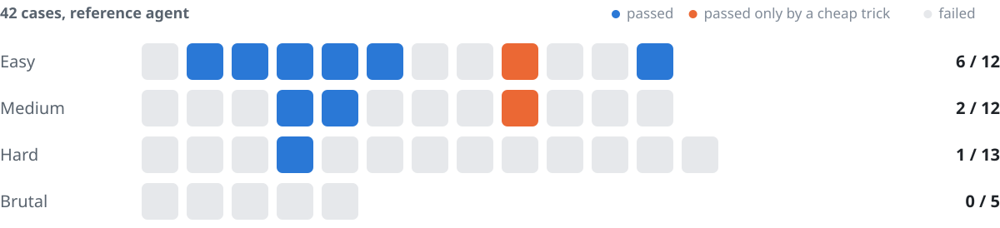

# hard-rag-evals

across 42 cases covering 14 ways an agent answering from documents can go wrong, an agent that invents its citations scores 0 of 42, because an answer that looks sourced can still be made up


<picture>
  <source media="(prefers-color-scheme: dark)" srcset="docs/assets/hero-dark.svg">
  
</picture>

## The numbers

The suite has 42 cases in four tiers: 12 easy, 12 medium, 13 hard, 5 brutal. Twelve of the 14 failure modes build one case at easy, medium, and hard. Adversarial retrieval builds 2 cases and compositional builds 4.

Each case gives the agent a small set of documents and a question. The agent answers from the documents and cites the ones it used.

- The reference agent retrieves documents by shared words and answers with extracts from them. It passes 9 of 42: 6 of 12 easy, 2 of 12 medium, 1 of 13 hard, 0 of 5 brutal.
- The same agent with one invented citation added to every answer passes 0 of 42.
- Every case has an answer written by hand that passes it, 42 of 42, in [tests/gold_answers.json](tests/gold_answers.json). Breaking any one of those answers, by dropping a required citation, adding a forbidden or invented one, flipping its refusal, or hedging instead of comparing, fails the case. Writing them found one case no answer could pass, now fixed.
- Six more agents each add one cheap trick to the reference agent. None gains a case. Appending every number in the documents, every pairwise sum, and the total used to win numeric-easy; it now scores 9 of 42, the reference score, and so does appending one guessed total. Adding "However, the sources may conflict." gains nothing, and neither does opening the answer with the question; each of those used to win 2 cases. Citing every retrieved document scores 8 of 42. Refusing every question scores 3 of 42, which is exactly the 3 cases where the documents hold no answer.

With 42 cases the counts are coarse. The reference agent's 9 of 42 is a pass rate of 0.21 with an exact 95% interval of 0.10 to 0.37, and no trick agent differs from it on a paired exact McNemar test after Holm correction (smallest adjusted p 0.876). The reports print both.

## How grading works

<picture>
  <source media="(prefers-color-scheme: dark)" srcset="docs/assets/flow-animated-dark.svg">
  
</picture>

A case passes only when every hard gate holds. The agent must refuse exactly when the documents hold no answer. Every document the case requires must be cited, no forbidden document may be cited, and every citation must name a document that exists. When a case sets them, the contradiction, numeric, order, and forbidden phrase checks must also pass. The numeric check wants the answer to commit: one figure within tolerance, and no other figure that is not quoted from the question or the documents. The contradiction check wants one sentence that names both conflicting claims and a word that marks the disagreement, "changed from 30 to 14 days". The order check wants each event named whole in one sentence, the product with its date, the earlier event first.

Four scores are computed for every case: citation precision, citation recall, retrieval recall, and faithfulness. The scores are reported and never decide a pass.

## Run it

No API key, no model calls, no network. Grading is deterministic.

```bash
pip install -e .
python examples/demo.py
python examples/grader_attacks.py
python -m pytest
```

The test suite is 126 tests. `python scripts/export_dataset.py OUT_DIR` writes the cases, each with its reference answer, as the JSON Lines file published on Hugging Face.

## What the grader does not check

These limits are in the code, stated here so nobody has to find them.

- Faithfulness counts a citation as supported when the cited document shares one content word with the answer. It is a weak score, and it never gates.
- The numeric check wants a figure within tolerance of the expected one and no other figure of the answer's own. Numbers that appear in the question, the documents, or their dates can be quoted freely. An intermediate result written in digits, "2024 + 2 = 2026, plus 1 is 2027", counts as a second figure and fails a correct answer.
- The contradiction check matches claims as whole tokens and uses 12 marker words such as "however", "changed", and "replaced". A sentence can hold both claims and a marker word and still get the direction wrong, "changed from 14 to 30 days". The order check reads the order of mention, not the grammar, so "Vega launched in November 2024, after Aurora in March 2024" fails a correct claim.
- There is no freshness check anywhere in the grader. Cases about stale documents are enforced one at a time, through lists written into each fixture: 39 of 42 cases name documents that must be cited, and 16 name documents that must not be cited.
- Each fixture carries an expected answer written in prose. The grader loads it and never reads it.

## Limits

- No model has been run through this suite. The only agents are the reference agent, the variant that invents citations, and the six trick agents. All of them are scripted.
- Every document set is hand built and small. No case has more than 50 documents, and there is no measured human baseline.
- The six trick agents were written against these checks by the same author. Their scores are pinned by tests, so hardening a check is expected to break the matching test and be recorded.
