# hard-rag-evals

across 45 cases covering 15 ways an agent answering from documents can go wrong, an agent that invents its citations scores 0 of 45, because an answer that looks sourced can still be made up


<picture>
  <source media="(prefers-color-scheme: dark)" srcset="docs/assets/hero-dark.svg">
  
</picture>

## The numbers

The suite has 45 cases in four tiers: 13 easy, 13 medium, 14 hard, 5 brutal. Thirteen of the 15 failure modes build one case at easy, medium, and hard. Adversarial retrieval builds 2 cases and compositional builds 4.

Each case gives the agent a small set of documents and a question. The agent answers from the documents and cites the ones it used.

- The reference agent retrieves documents by shared words and answers with extracts from them. It passes 10 of 45: 7 of 13 easy, 2 of 13 medium, 1 of 14 hard, 0 of 5 brutal.
- The same agent with one invented citation added to every answer passes 0 of 45.
- Six more agents each add one cheap trick to the reference agent. Citing every retrieved document and adding the sentence "However, the sources may conflict." scores 11 of 45. Appending every number in the documents, every pairwise sum, and the total scores 11 of 45. Citing every retrieved document scores 9 of 45. Refusing every question scores 3 of 45, which is exactly the 3 cases where the documents hold no answer.
- Two of the six tricks aim at the agent's own report of what it retrieved. Reporting every document in the corpus as retrieved scores 8 of 45. Reading the whole corpus past the budget, answering from all of it, and reporting only the budgeted part scores 9 of 45. Neither turns a case the reference agent fails into a pass. The section below on the retrieval report gives the scores both agents reach when the report is taken at its word.

## How grading works

<picture>
  <source media="(prefers-color-scheme: dark)" srcset="docs/assets/flow-animated-dark.svg">
  
</picture>

A case passes only when every hard gate holds. The agent must refuse exactly when the documents hold no answer. Every document the case requires must be cited, no forbidden document may be cited, and every citation must name a document that exists. When a case sets them, the contradiction, numeric, order, and forbidden phrase checks must also pass.

Four scores are computed for every case: citation precision, citation recall, retrieval recall, and faithfulness. The scores are reported and never decide a pass.

## The retrieval report, checked against the corpus

Every answer carries the ids of the documents the agent says it retrieved. Grading used to score that list as reported. It now checks the list against the corpus and the case budget first. An id counts only when it names a document in the corpus, it is reported once, and it fits inside the budget in the order reported: at most the allowed number of documents, and at most the allowed number of characters, with the same allowance the retriever itself makes for a first document that passes the character cap on its own. Retrieval recall is computed from the ids that pass this check, and a citation counts only when the cited document is in that checked set. An answer that cites a document outside it fails the case, and so does a report that names a document that does not exist, names one twice, or names more than the budget allows.

Three new cases test this directly. Each pairs a budget of 2 or 3 documents with documents stuffed with the query words, so an honest retrieval inside the budget never reaches the documents that answer. The table gives the scores of the two report tricks under both ways of grading, measured on the full 45 case suite. The grader that trusts the report is the previous version of this code, run unchanged on the same cases and agents.

| Agent | Report taken at its word | Report checked against the corpus |
| --- | --- | --- |
| Reads the whole corpus past the budget, reports only the budgeted part | 16 of 45 | 9 of 45 |
| Reports every document in the corpus as retrieved | 10 of 45, retrieval recall 1.00 on all 45 cases | 8 of 45, checked retrieval recall 0.93 averaged over the suite |

The reference agent scores 10 of 45 under both ways of grading. Its report was already accurate, so the check changes nothing for it.

## Run it

No API key, no model calls, no network. Grading is deterministic.

```bash
pip install -e .
python examples/demo.py
python examples/grader_attacks.py
python -m pytest
```

The test suite is 51 tests.

## What the grader does not check

These limits are in the code, stated here so nobody has to find them.

- Faithfulness counts a citation as supported when the cited document shares one content word with the answer. It is a weak score, and it never gates.
- The contradiction check needs both documents of a conflicting pair cited, then looks for any of 12 marker words in the answer, words such as "however", "changed", and "replaced". An answer that copies one of those words out of a document passes without comparing the two claims.
- There is no freshness check anywhere in the grader. Cases about stale documents are enforced one at a time, through lists written into each fixture: 42 of 45 cases name documents that must be cited, and 16 name documents that must not be cited.
- Each fixture carries an expected answer written in prose. The grader loads it and never reads it.
- The retrieval report check shows the report fits the corpus and the budget, and that every citation names a document inside the checked set. It cannot show the agent's retriever actually ran. A report that names only documents the agent could have pulled inside the budget, and cites only those documents, passes this check.

## Limits

- No model has been run through this suite. The only agents are the reference agent, the variant that invents citations, and the six trick agents. All of them are scripted.
- Every document set is hand built and small. No case has more than 50 documents, and there is no measured human baseline.
- The six trick agents were written against these checks by the same author. Their scores are pinned by tests, so hardening a check is expected to break the matching test and be recorded.
