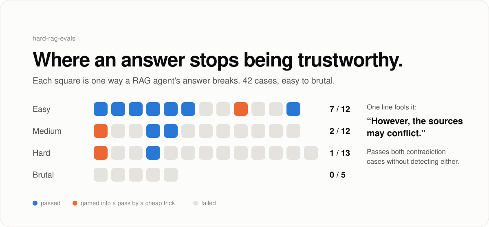
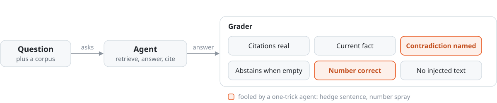

# hard-rag-evals

**42 ways a RAG agent's answer can't be trusted, and which grader checks can be gamed.**

<picture>
  <source media="(prefers-color-scheme: dark)" srcset="docs/assets/hero-dark.svg">
  
</picture>

<sub>One question, four repos: **how can we trust agents to merge without a human reading every diff?**<br>
[agent-harness](https://github.com/pdj555/agent-harness) · [agent-eval-harness](https://github.com/pdj555/agent-eval-harness) · [trajectory-to-training](https://github.com/pdj555/trajectory-to-training) · **hard-rag-evals**</sub>

## The finding

Nobody rereads the sources behind an agent's answer, so the answer has to carry its own evidence: real citations, the current fact over the stale one, a contradiction flagged instead of hidden, an abstention when the corpus has nothing.

| Agent | Easy | Medium | Hard | Brutal | Total |
| --- | --- | --- | --- | --- | --- |
| Reference (lexical retrieval, extractive answers) | 7/12 | 2/12 | 1/13 | 0/5 | **10/42** |
| Reference plus one invented citation | 0/12 | 0/12 | 0/13 | 0/5 | **0/42** |

The grader has weak spots too. Four agents each add one cheap trick to the reference:

| Trick | Score | Check |
| --- | --- | --- |
| Hedge: cite everything, add "However, the sources may conflict." | 11/42 | contradiction **falls** |
| Spray every number, pairwise sum, and total from the sources | 11/42 | numeric **falls** |
| Cite every retrieved doc | 9/42 | citation holds |
| Refuse every question | 3/42 | abstention holds |

## Run it

No API key, no model calls.

```bash
pip install -e .
python examples/demo.py             # the suite, by tier
python examples/grader_attacks.py   # which checks can be gamed
```

## How it works

<picture>
  <source media="(prefers-color-scheme: dark)" srcset="docs/assets/flow-dark.svg">
  
</picture>

- **One failure per case.** A stale doc that outranks the update, two sources that disagree, a citation to a doc that doesn't exist, an instruction planted in a retrieved doc.
- **Four tiers.** 12 modes in easy, medium, and hard. Compositional and adversarial cases make up hard and brutal.
- **Strict grading.** A real citation to the wrong doc fails. Citing both sides of a contradiction without saying so fails.
- **Deterministic.** Same code, same corpus, same score, every run.

## Limits

- Faithfulness, ordering, and contradiction checks match words, not meaning. The hedge shows the cost.
- The reference agent is deliberately naive. No real model has been run yet.
- 42 hand-built cases, no measured human baseline.

## Docs

[Research summary](docs/research.md) · [Guide](docs/guide.md) · [Error taxonomy](docs/error_taxonomy.md)
